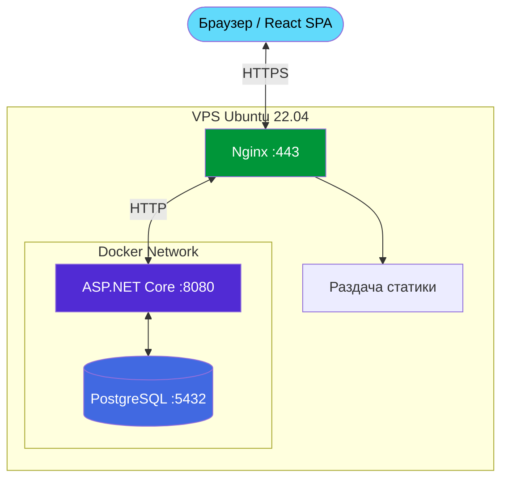

<p align="center">
  
</p>

<h1 align="center">Платформа студенческого совета СГН</h1>

<p align="center">
  Веб-приложение для управления студенческим советом: участники, мероприятия, бейджи, аналитика.
</p>

<p align="center">
  <a href="https://studsovetsgn.ru"></a>
  
  
  
  
</p>


## О проекте

Внутренняя платформа для студенческого совета СГН МГТУ им. Н.Э. Баумана. Заменяет ручной учёт в таблицах и мессенджерах единой системой с ролевой моделью, геймификацией и аналитикой.

**Основные возможности:**

-  **Пользователи:** учёт участников, роли (Admin / Leader / Member), система уровней и баллов.
-  **Мероприятия:** создание, регистрация, учёт явки, бюджетирование.
-  **Бейджи:** выдача цифровых подтверждений с возможностью загрузки PDF.
-  **Аналитика:** дашборды со статистикой, топами и динамикой по месяцам.
-  **Безопасность:** Cookie-аутентификация, поддержка 2FA (TOTP), защита от удаления последнего админа.

---

## Стек технологий

**Backend:**
-  ASP.NET Core 8 (C#)
-  PostgreSQL 16 (EF Core)

**Frontend:**
-  React 19 + Vite
-  Chart.js (визуализация данных)

**Инфраструктура:**
-  Docker + Docker Compose
-  Nginx (reverse proxy)
-  Ubuntu 22.04 (VPS)

---

## Архитектура

Проект представляет собой **слоистый монолит**. Backend разделён на три слоя:

- **`StudentCouncil.Data`** — модели, `AppDbContext`, миграции EF Core.
- **`StudentCouncil.Logic`** — DTO, бизнес-логика (сервисы), интерфейсы, кастомные исключения.
- **`StudentCouncil.Web`** — REST API контроллеры, middleware для обработки ошибок, настройка DI.
- **`StudentCouncil.Frontend`** — SPA на React (Vite), взаимодействует с API.



---

## Локальный запуск

**Требования:** .NET 8 SDK, Node.js 20+, PostgreSQL 16 (или Docker Desktop).

### 1. Настройка базы данных
Создайте файл `StudentCouncil.Web/appsettings.Development.json` и укажите строку подключения к вашей локальной БД:

```json
{
  "ConnectionStrings": {
    "DefaultConnection": "Host=localhost;Port=5432;Database=studsovet;Username=postgres;Password=ваш_пароль"
  }
}
```

### 2. Запуск Backend

```bash
# Применить миграции
dotnet ef database update --project StudentCouncil.Data --startup-project StudentCouncil.Web

# Запустить сервер
dotnet run --project StudentCouncil.Web
```

API будет доступно по адресу: `http://localhost:8080` (Swagger: `/swagger`).

### 3. Запуск Frontend

```bash
cd StudentCouncil.Frontend
npm install
npm run dev
```
Сайт откроется на `http://localhost:5173`.

---

## Docker

Для запуска всего проекта одной командой используется Docker Compose.

```bash
# Создать .env файл с паролем для БД
echo "DB_PASSWORD=ваш_сложный_пароль" > .env

# Поднять контейнеры
docker compose up -d

# Посмотреть логи backend
docker logs studentcouncil_backend --tail 50
```

**Контейнеры:**

| Сервис | Порт | Назначение |
|--------|------|-----------|
| `postgres` | 127.0.0.1:5432 | PostgreSQL 16 |
| `backend` | 8080 | ASP.NET Core 8 |
| `frontend` | 8081 | Nginx со статикой React |

*Для сохранения данных используются Docker-volumes: `postgres_data` (БД), `backend_wwwroot` (файлы) и `backend_logs` (логи).*

---

## Документация API

-  [Swagger UI (GitHub Pages)](https://digital-sgn.github.io/StudentCouncilPlatform-API)
-  [openapi.yaml](openapi.yaml) — спецификация в репозитории
- Локально в dev-режиме: `http://localhost:8080/swagger`

---

## Ссылки

-  Сайт: [studsovetsgn.ru](https://studsovetsgn.ru)
-  Справочник отдела: [Handbook](https://github.com/Digital-SGN/Handbook)
-  Организация на GitHub: [Digital-SGN](https://github.com/Digital-SGN)

<br/>

<p align="center">
  <sub>Отдел цифрового развития ССФ СГН · 2026</sub>
</p>
